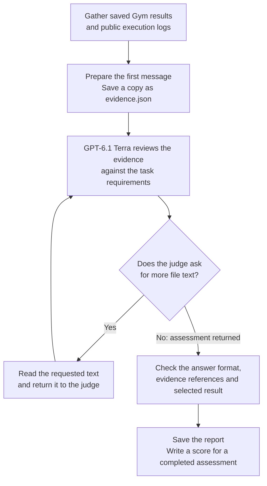

<!--
Source: https://gitlab-master.nvidia.com/hwolff/pare-harbor-tasks
Revision: 7acf882c86a724a67075ae729608500e8a95e0a7
Original file: tasks/gym-fm-02/README.md
Source license: not declared in source file; contribution clearance pending
-->
# GYM-FM-02: Use NeMo Gym

Evaluate the installed Gym Workplace Assistant Carlos example using the harness
and model in `GYM_AGENT` and `GYM_MODEL`. Save a genuine scored rollout under
`/workspace`. See [the dataset guide](../README.md) for installation, validation
and evaluation commands, and [Task.md](Task.md) for the preserved specification.

Gym runs the outer coding agent in a fresh Docker sandbox. The agent configures
and evaluates the bundled Carlos email task with the selected inner Gym harness.
GPT-6.1 Terra then reviews the saved result and public execution records.
All 4 workflow criteria must pass for workflow reward 1. A valid inner Gym
email reward of 0 can still earn workflow reward 1.

## Select the inner Gym agent

Select the inner Codex or Claude harness with
[`gym-fm-02-codex.yaml`](../config/gym-fm-02-codex.yaml) or
[`gym-fm-02-claude.yaml`](../config/gym-fm-02-claude.yaml), passed to Gym with
`--config`. Each preset directly defines the outer Codex/Sol connection,
Docker settings and inner harness/model. No `GYM_AGENT` or `GYM_MODEL` export is
needed when using a preset.

| Role | Model | Connection |
| --- | --- | --- |
| Outer coding agent | `openai/openai/gpt-6.1-sol`, high reasoning | Inference Hub through the preset's Gym Model Server. |
| Inner Gym agent | Codex with `openai/openai/gpt-5.4-mini`, or Claude Code with `aws/anthropic/bedrock-claude-haiku-5-5` | The supplied `OPENAI_BASE_URL` and `OPENAI_API_KEY`. |
| Workflow judge | `azure/openai/gpt-6.1-terra`, high reasoning | Hub Responses through `VERIFIER_JUDGE_*` in `task.toml`. |

The selected inner harness and model reach the outer agent, reference solution
and shared verifier through the preset's `task_env` mapping. Both inner harnesses
use Gym's local model proxy; Claude Code uses its Messages adapter.

See [reference validation](../README.md#validate-the-reference-solutions),
[outer-agent evaluation](../README.md#evaluate-the-outer-coding-agent) and
[developer checks](../README.md#developer-checks) for commands.
Before each FM02 run, export a fresh UUID-based `PARE_FM02_FIXTURE_VOLUME` as
described in the dataset guide. The presets mount it read-only at
`/opt/gym-fixture`; Docker copies the image's sample fingerprints into it.
Remove that run's named volume after Gym exits and its sandboxes stop.

## How verification works

After the outer agent finishes, Gym runs `tests/test.sh` in the task sandbox.
The Workplace verifier has already scored the email task. GPT-6.1 Terra checks
whether the requested product workflow happened.

| File | What it does |
| --- | --- |
| [test.sh](tests/test.sh) and [verify.py](tests/verify.py) | Clear stale rewards, load reference data and sample fingerprints, collect evidence and save the assessment. |
| [read_execution.py](tests/read_execution.py) | Find possible saved results and public execution records; list, read or search evidence requested by the judge. |
| [hybrid.py](tests/hybrid.py) | Send evidence to the judge, handle requests for more text, validate the answer and retain diagnostics. |
| [judge-prompt.md](tests/judge-prompt.md) | Explain how to connect evidence from the same execution and handle uncertainty and review limits. |
| [grading-criteria.md](tests/grading-criteria.md) | Define the 4 requirements and 8 saved-result evidence facts. |
| [reference.json](tests/reference.json) | Store the Carlos request, supported harnesses, requirement IDs and fact IDs. |

The judge checks the Carlos request, actual evaluation through Gym's CLI or
Python API, execution of the requested Gym harness, and a genuine scored result
saved under `/workspace` during the attempt. It connects the result to runtime
records and reliable completion of that same evaluation. Configuration and
component names alone do not establish that the requested harness ran.

Gym retains outer Codex session logs under `/logs/agent/sessions`. The evidence
reader extracts public tool calls, results and IDs from them. Reference runs
supply `oracle.txt`, the known `solve.sh` and its recorded exit status.

In `evidence.json`, `files` lists available evidence and `contents` holds text
sent immediately. Complete result and execution files are included when they
fit the initial budget. Other text remains available through `list_evidence`,
`read_evidence` and `search_evidence`. Later requests and returned text are saved
in `file-access.json`; they are not added to the initial `evidence.json`.

Each nonblank text section has an `excerpt_id`. The judge cites these IDs for
its findings and selected result. Python rejects references that were not
delivered and records each cited section's path, offsets and exact text in the
report's `citations`. The judge decides what the cited evidence establishes.

| Outcome | Meaning |
| --- | --- |
| Workflow reward 1 | A completed assessment supports all 4 requirements. |
| Workflow reward 0 | A completed assessment does not support all 4 requirements. |
| Inner Gym email reward | Email quality, separate from the workflow reward; a valid 0 is acceptable. |
| Judge or verifier error | No reward file; inspect Gym's `failure_kind` and the verifier report. |

Judge API errors, invalid answers and exhausted review budgets that prevent an
assessment leave no reward file and exit unsuccessfully. Gym represents a
missing reward as numeric 0 with `failure_kind=harbor:missing_reward`.
Inspect that field before calling a numeric 0 an assessed workflow failure.
The verifier clears stale reward files before starting and publishes a reward
only after saving the completed assessment's report.

## Inspect results and reports

Start with `<output-stem>_run_summary.json` beside the outer rollout file and
inspect the trial's `failure_kind`, verifier status and `paths` entries.
The default result root is `results/harbor/gym-fm-02/` for evaluations and
`results/harbor/validation/gym-fm-02/` for reference validation.

`paths.verifier_logs` points to a unique `verifier/session-<id>/` folder.
Resolve relative paths from the summary's directory. A custom `--output` moves
the rollout and summary; verifier logs can remain under the task's default
result root. Follow the recorded path to the matching session.

Inside that verifier folder, inspect:

| Path | What it contains |
| --- | --- |
| `report.json` | Completed assessment or error, requested inner harness/model, candidate scores and selected email reward. |
| `reward.txt` | Workflow reward, present only for a completed assessment. |
| `test-stdout.txt` | Verifier process output. |
| `trajectory.json` | Exported outer-agent trajectory. |
| `hybrid/evidence.json` | Initial evidence and file catalog sent to the judge. |
| `hybrid/contract.json` and `hybrid/rubric.txt` | Requirement IDs and the combined judge prompt and criteria. |
| `hybrid/answer.txt` and `hybrid/report.json` | Final judge answer, findings, citations and diagnostics. |
| `hybrid/file-access.json` | Additional evidence requests and returned text, when requested. |
| `hybrid/request-attempts.json` | Request timing, HTTP status and server errors. |

For an HTTP rejection, `request-attempts.json` retains up to 16,000 bytes of the
server's error response and marks longer responses as truncated. Some report
files are absent when verification stops before reaching that step.

The verifier also retains possible result files inside the sandbox under
`/logs/artifacts/gym-fm-02-hybrid/<hash>/`, with an additional selected
`rollout.jsonl` for a supported pass. Host artifact availability is recorded in
the summary's `paths.artifacts`; a null value means no host artifact path was
recorded. Use that path and its collection manifest when available, rather than
assuming the sandbox artifact directory was downloaded. The judge's saved
evidence and citations remain in the verifier reports.

The report's top-level `gym_reward` belongs to the selected result. If the judge
selects none, it is null; available candidate scores remain under `saved_results`.
See [Task.md](Task.md) for the full verifier contract and evidence limits.
